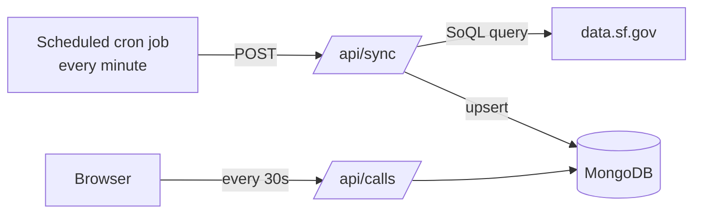

# SF Police Scanner

A live map and feed of San Francisco police calls for service, built with Next.js and deployed on Vercel.

## How it works



1. Every minute, a scheduled cron job sends a POST to `/api/sync`.
2. `/api/sync` fetches new or updated calls from DataSF and writes them to MongoDB.
3. The browser reads from MongoDB through `/api/calls` and `/api/days`. It refreshes every 30 seconds.

The app never queries DataSF directly from the browser. All reads go to our own database.

## Where the data comes from

The data is the **Law Enforcement Dispatched Calls for Service: Real-Time** dataset on [DataSF](https://data.sf.gov/d/gnap-fj3t). It's a public Socrata dataset. As of the SODA3 API, requests must be authenticated with an API key and secret (HTTP Basic Auth), set via `SCANNER_API_KEY` and `SCANNER_API_SECRET`.

`lib/sync.ts` queries the DataSF endpoint (set via `SCANNER_API_URL`, default `https://data.sf.gov/api/v3/views/gnap-fj3t/query.json`) as follows:

- **Incremental fetches.** It only fetches rows whose `call_last_updated_at` is at or after the last saved cursor, so each run only pulls changes.
- **First run.** The first sync backfills the last 7 days.
- **Paging.** Each run fetches up to 10 pages of 1,000 rows, so it fits within the serverless timeout. A large backlog catches up over several runs.
- **Minimum interval.** A run that starts less than 30 seconds after the last sync is skipped.
- **Concurrency.** Concurrent runs on the same server instance share a single sync.

## Where it's stored

The data lives in MongoDB (Atlas), in the `sf_police_scanner` database:

| Collection | Contents |
| --- | --- |
| `calls` | One document per call, upserted by `id`. Socrata system fields are removed, and `received_date` (`YYYY-MM-DD`, SF local time) is added for querying by day. |
| `meta` | A single `{ _id: "sync" }` document holding the sync `cursor`, `lastSyncAt`, and `dataAsOf`. |

The app creates the indexes on startup: a unique index on `id`, and a compound index on `received_date` + `received_datetime`.

## Scheduling the sync

`/api/sync` needs to be called on a schedule to keep the data fresh. Any service that can send an HTTP `POST` every minute works, such as a hosted cron service or a self-hosted cron job running `curl`.

> The production deployment is driven by a private scheduler (cron.colinfran.com) that is **not** publicly accessible. Set up your own scheduler to run your deployment.
>
> **Why not Vercel Cron?** On the Hobby plan Vercel Cron runs at most once per day, so it can't drive a per-minute sync. Use an external scheduler that supports a `* * * * *` schedule.

**Configure your cron job:**

- **Method / URL:** `POST https://<your-deployment>/api/sync`
- **Schedule:** `* * * * *` (every minute)
- **Auth (pick one):**
  - **Custom header:** `Authorization: Bearer <CRON_SECRET>`, or
  - **Request body:** `{"secret": "<CRON_SECRET>"}`
- **Timeout:** `30000` (ms)

**Auth.** `/api/sync` accepts the secret two ways: an `Authorization: Bearer <CRON_SECRET>` header, **or** a JSON request body of `{"secret": "<CRON_SECRET>"}`. Use whichever your cron service supports. If `CRON_SECRET` is not set (local dev), the endpoint is open with a per-IP rate limit.

**Manual sync:**

```sh
curl -X POST https://<your-deployment>/api/sync -H "Authorization: Bearer <CRON_SECRET>"
```

## Environment variables

| Variable | Where | Purpose |
| --- | --- | --- |
| `MONGODB_URI` | Vercel + local | MongoDB connection string |
| `CRON_SECRET` | Vercel + local | Shared secret that authorizes `/api/sync` (sent by your scheduler, and for manual triggers) |
| `SCANNER_API_URL` | Vercel + local (optional) | DataSF query endpoint. Defaults to the `gnap-fj3t` dataset. |
| `SCANNER_API_KEY` | Vercel + local | SODA3 API key (Basic Auth username) for data.sf.gov. |
| `SCANNER_API_SECRET` | Vercel + local | SODA3 API secret (Basic Auth password) for data.sf.gov. |

Copy `.env.example` to `.env.local` for local development. Vercel only picks up environment variable changes on the next deploy.

## Local development

```sh
npm install
npm run dev
```

Your scheduler likely can't reach `localhost`, so trigger syncs locally by hand. Include the header only if `CRON_SECRET` is set locally:

```sh
curl -X POST http://localhost:3000/api/sync -H "Authorization: Bearer $CRON_SECRET"
```

## Project layout

- `app/api/sync`: pulls from DataSF into MongoDB (called by your scheduler)
- `app/api/calls`: calls for a given day (`?date=YYYY-MM-DD`)
- `app/api/days`: call counts for the last 14 days
- `app/calls/[id]`: shareable page for a single call
- `components/`: map, list, filters, stats, and drawer UI
- `lib/sync.ts`: the sync logic
- `lib/mongodb.ts`: the MongoDB client and indexes
